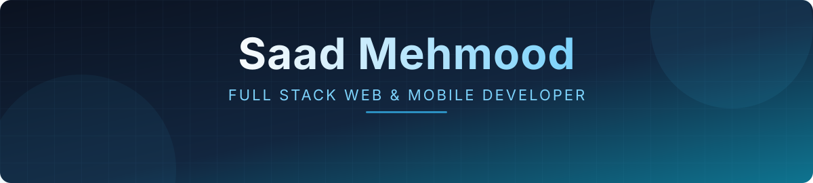

<!-- ===================== HEADER ===================== -->

  
  
  
  

  <a href="#about">About</a> &nbsp;&middot;&nbsp;
  <a href="#tech-stack">Tech Stack</a> &nbsp;&middot;&nbsp;
  <a href="#what-i-build">What I Build</a> &nbsp;&middot;&nbsp;
  <a href="#github-analytics">Analytics</a> &nbsp;&middot;&nbsp;
  <a href="#contact">Contact</a>

<!-- ===================== ABOUT ===================== -->
<h2 align="center" id="about">About</h2>

  I'm a <b>Computer Science student at Virtual University</b> and a full stack developer focused on building 
  scalable <b>web applications, APIs, and mobile apps</b>. I enjoy solving problems, learning new tools, 
  and turning ideas into production-ready products.

  <table>
    <tr>
      <td width="170" align="left"><b>Education</b></td>
      <td align="left">B.S. Computer Science &mdash; Virtual University</td>
    </tr>
    <tr>
      <td width="170" align="left"><b>Role</b></td>
      <td align="left">Full Stack Developer (Web &amp; Mobile)</td>
    </tr>
    <tr>
      <td width="170" align="left"><b>Core Stacks</b></td>
      <td align="left">MERN &middot; NestJS &middot; LAMP &middot; Laravel &middot; CakePHP &middot; React Native</td>
    </tr>
    <tr>
      <td width="170" align="left"><b>Databases</b></td>
      <td align="left">PostgreSQL &middot; MySQL &middot; MongoDB &middot; Firebase</td>
    </tr>
    <tr>
      <td width="170" align="left"><b>Focus</b></td>
      <td align="left">Scalable backend systems and modern frontend architecture</td>
    </tr>
    <tr>
      <td width="170" align="left"><b>Currently Learning</b></td>
      <td align="left">Advanced NestJS patterns, system design, and AWS</td>
    </tr>
  </table>

<!-- ===================== TECH STACK ===================== -->
<h2 align="center" id="tech-stack">Tech Stack</h2>

  <table>
    <tr>
      <td width="170" align="left"><b>Frontend</b></td>
      <td align="left">
        
        
        
        
        
        
        
        
      </td>
    </tr>
    <tr>
      <td width="170" align="left"><b>Backend</b></td>
      <td align="left">
        
        
        
        
        
        
      </td>
    </tr>
    <tr>
      <td width="170" align="left"><b>Database &amp; Cloud</b></td>
      <td align="left">
        
        
        
        
        
      </td>
    </tr>
    <tr>
      <td width="170" align="left"><b>Tools</b></td>
      <td align="left">
        
        
        
        
      </td>
    </tr>
  </table>

<!-- ===================== WHAT I BUILD ===================== -->
<h2 align="center" id="what-i-build">What I Build</h2>

  <table>
    <tr>
      <td width="33%" valign="top" align="left">
        <h4>Mobile Applications</h4>
        <ul>
          <li>React Native apps with REST API integration</li>
          <li>Secure authentication flows</li>
          <li>Redux state management</li>
          <li>Firebase services</li>
        </ul>
      </td>
      <td width="33%" valign="top" align="left">
        <h4>Web Applications</h4>
        <ul>
          <li>MERN stack applications</li>
          <li>Laravel &amp; CakePHP enterprise systems</li>
          <li>Responsive UIs with React &amp; Next.js</li>
        </ul>
      </td>
      <td width="33%" valign="top" align="left">
        <h4>APIs &amp; Backend</h4>
        <ul>
          <li>RESTful APIs with NestJS &amp; Express</li>
          <li>Modular, scalable architecture</li>
          <li>PostgreSQL, MySQL &amp; MongoDB design</li>
        </ul>
      </td>
    </tr>
  </table>

<!-- ===================== ANALYTICS ===================== -->
<h2 align="center" id="github-analytics">GitHub Analytics</h2>

  
  
   
  
   
  

<!-- ===================== CONTACT ===================== -->
<h2 align="center" id="contact">Contact</h2>

I'm open to collaboration and development opportunities.

  
  

